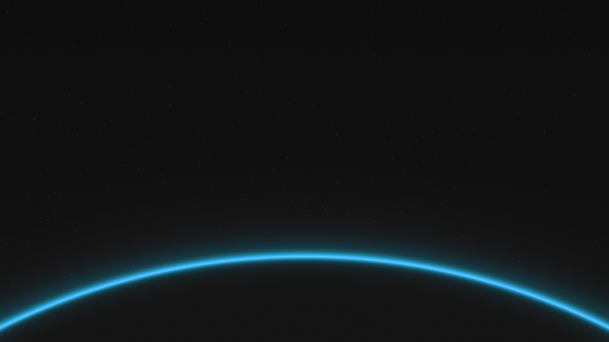

# Oxocarbon Dark

A customised build of the original Oxocarbon Dark theme for Omarchy by HANCORE-linux.

- **What it is:** a theme for Omarchy, the Arch Linux desktop.
- **What it does:** paints the whole desktop in the Oxocarbon Dark palette and adds a dark-toned horizon wallpaper. It also lifts the top bar to `#262626`, so the bar separates from the wallpaper.
- **What it needs:** Omarchy on Arch Linux. Nothing else.
- **How to start:** run `omarchy-theme-install https://github.com/iliFalk/omarchy-oxocarbon-theme-dark.git`. It clones the theme and applies it at once.

## Install

1. Run `omarchy-theme-install https://github.com/iliFalk/omarchy-oxocarbon-theme-dark.git`. It clones the theme to `~/.config/omarchy/themes/oxocarbon-theme-dark` and applies it.
2. To apply it again later, run `omarchy-theme-set oxocarbon-theme-dark`.

Omarchy names the theme after the repository, so the theme menu lists it as **Oxocarbon Theme Dark**.

## Use

| Where | What it does |
|---|---|
| Theme menu | **Oxocarbon Theme Dark** applies the full palette to the shell, the bar, the launcher and the notifications. |
| Terminal | Alacritty, Ghostty, Kitty and Foot take the palette that `colors.toml` defines. |
| Backgrounds | `backgrounds/` holds the horizon wallpaper that ships with the theme, `alt-backgrounds/` the alternates. |

## Settings

| File | Holds |
|---|---|
| `colors.toml` | The palette Omarchy generates the terminal colours from. |
| `backgrounds/`, `alt-backgrounds/` | The wallpapers the theme offers. |
| `custom_theme.json` | The theme entry that browsers and web apps read. |
| `waybar.css`, `mako.ini`, `walker.css`, `swayosd.css` | The bar, the notifications, the launcher and the volume overlay. |
| `preview.png` | The picture above. Replace it when the look changes. |

## Docs

- `docs/DEVELOPMENT.md` — the changes against the original theme, the credits and the licence.
- `LICENSE` — MIT.
